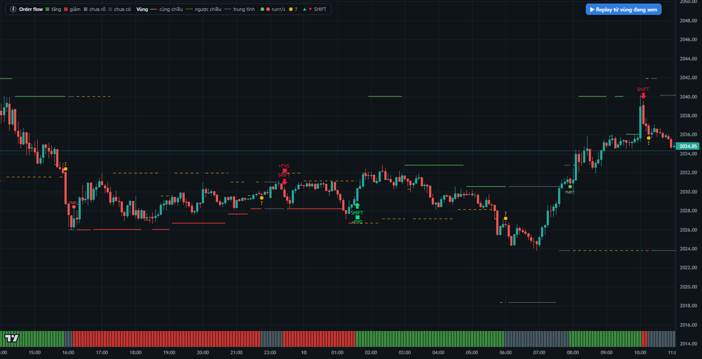
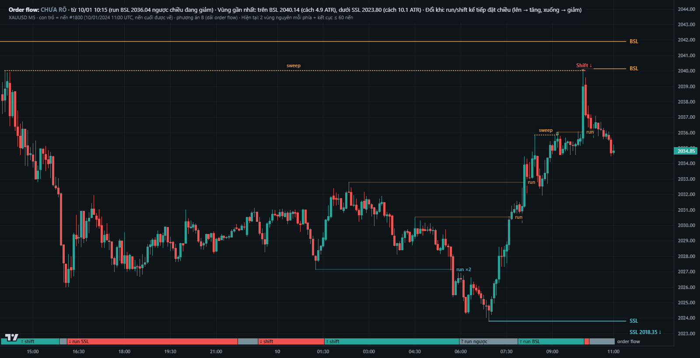
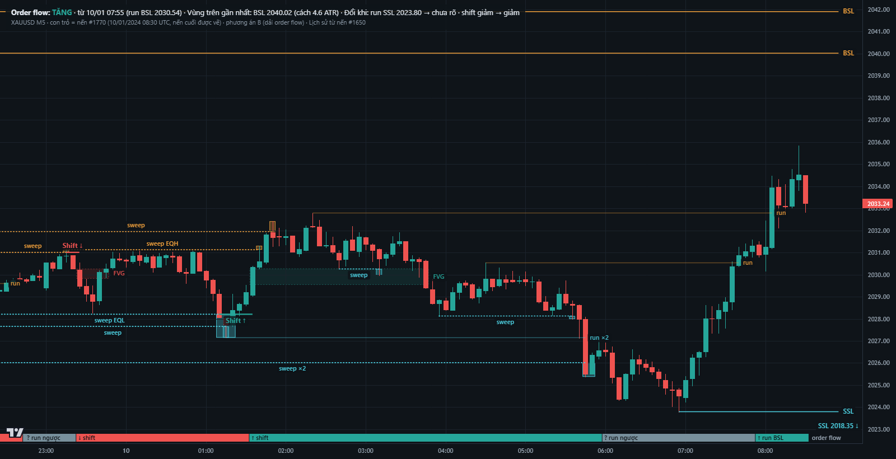
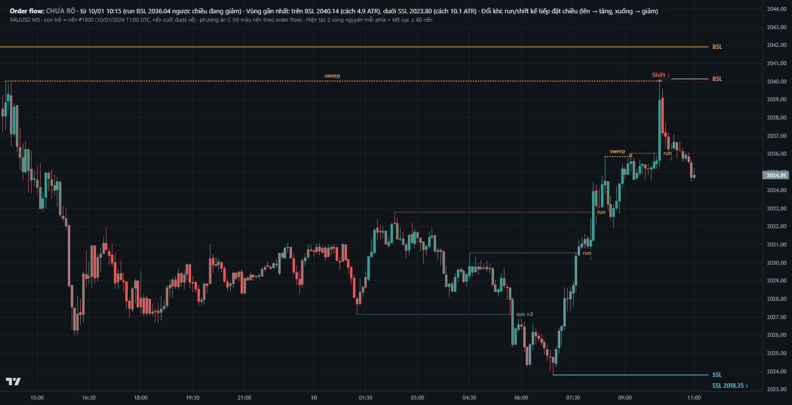
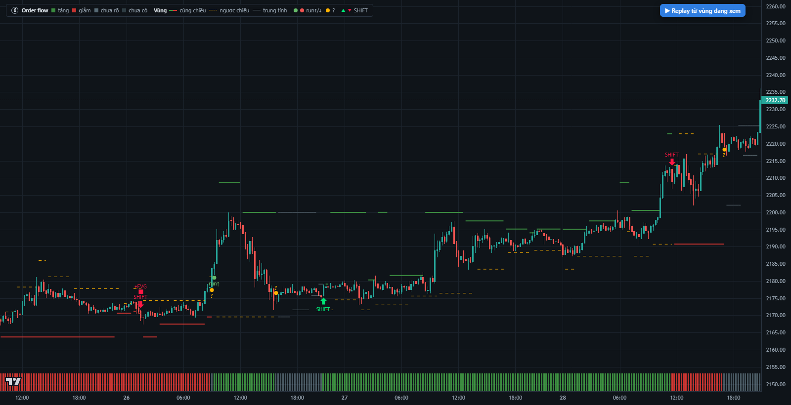
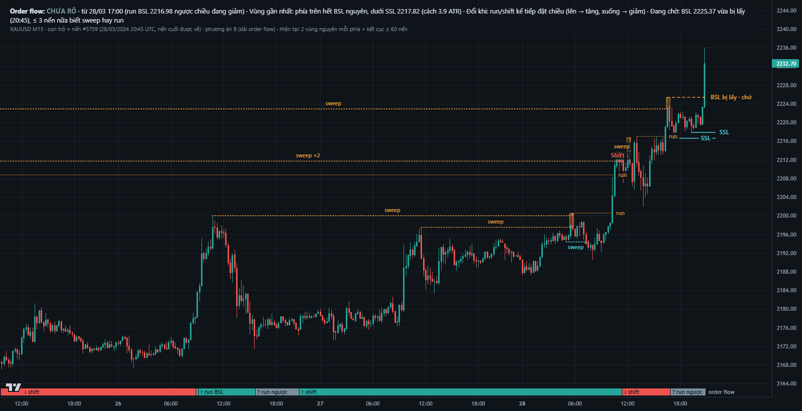

# Plan: hiển thị `ict_structure` trên chart theo cách các indicator ICT/SMC làm

Bản 1 — 06/10/2026. **Trạng thái: đã duyệt (06/10/2026, H1–H4 đúng theo đề xuất — §8); H-A, H-B đã cài
(06/10/2026 — kết quả nghiệm thu và chỗ cài khác plan ở §7.1–§7.2); H-C để sau. Lõi không đổi: `ict_structure` vẫn
0.3.0.**

Nguồn: [`nghien_cuu_hien_thi_indicator.md`](../research/nghien_cuu_hien_thi_indicator.md) — đọc mã Pine mở của
18 indicator (LuxAlgo SMC, Buyside & Sellside Liquidity, Liquidity Sweeps, ICT Concepts, TFO Killzones,
fadi ICT HTF MSS & Liquidity…) và docs Lightweight Charts 4.2. Ký hiệu S1–S27 trong plan này là nguồn ở
bản nghiên cứu đó.

Phạm vi: chỉ phần **vẽ** của plugin `frontend/js/algos/ict_structure.js` (và 3 lớp vẽ dùng chung mới trong
`frontend/js/chart/`). **Lõi không đổi**: không đổi sự kiện, timeline, phiên bản thuật toán, kết quả đã lưu.

---

## 1. Vấn đề

Người dùng thấy chart 0.3.0 «khó hiểu». Đối chiếu với các indicator, nguyên nhân cụ thể:

| Đang làm | Vì sao khó đọc |
|---|---|
| Chú giải toàn ký hiệu màu ở góc (ô màu, nét liền/đứt, chấm) | Phải tra từng màu. **Không indicator nào** trong 18 cái đã đọc mã dùng chú giải màu — chúng ghi chữ ngay trên đối tượng (S1–S19) |
| Đường vùng thanh khoản bắt đầu từ «nến sau lúc biết», chỉ vẽ 2 vùng gần nhất, đổi vai thì ngắt | Đường lơ lửng giữa chart, không biết là đỉnh/đáy nào; nhiều đoạn đứt ngắn trông như nhiễu. Mọi indicator vẽ **từ nến đỉnh/đáy gốc** (S1, S2, S6, S11) |
| Marker chấm «run↑», «?» đặt dưới/trên nến | Chấm tách rời không nói lấy cái gì, ở mức nào. Indicator vẽ sweep **ngay trên mức bị quét** (dấu x giữa đoạn hoặc hộp phần râu vượt mức — S3, S8, S9, S10) |
| Dải order flow mỏng ở đáy, không có chữ | Phải nhìn chú giải mới biết màu nào là gì. Dải trạng thái của indicator **ghi tên ngay trên dải** (S12) hoặc tô màu nến (S1, S10, S20, S21) |
| Mũi tên SHIFT tách khỏi mức bị quét | Không thấy chuỗi «quét → displacement → FVG». Indicator vẽ đổi chiều như MSS: **đoạn ngang + chữ giữa đoạn**, kèm hộp FVG (S1, S4, S11) |
| Mỗi lúc hiện cả trăm đối tượng (241 nến M5 có 41 vùng thanh khoản) | Indicator mặc định chế độ **«Hiện tại»**: 2–3 mức gần nhất mỗi phía, ẩn cái đã dùng (S2, S4) |

## 2. Nguyên tắc (rút từ các indicator)

1. **Chữ trên đối tượng, không chú giải màu.** Giải thích dài để khi rê chuột (tooltip) và ở dòng trạng thái.
2. **Đối tượng neo vào chỗ nó sinh ra**: mức thanh khoản bắt đầu ở nến đỉnh/đáy gốc, dừng ở nến bị lấy.
3. **Vòng đời bằng kiểu nét và chỗ dừng**: còn nguyên = nét liền kéo tới hiện tại; bị quét = nét chấm + «sweep»;
   bị run = mờ + «run».
4. **Màu có một nghĩa**: xanh/đỏ chỉ dùng cho **chiều** (order flow, shift, FVG). Mức thanh khoản dùng màu trung
   tính (BSL cam, SSL xanh ngọc — như S4, S11) để «BSL xanh» không bị đọc thành «tăng».
5. **Ít mà đủ**: mặc định chỉ thứ đang có hiệu lực quanh giá; lịch sử là tuỳ chọn.
6. **Nhân quả giữ nguyên**: đối tượng chỉ **xuất hiện** khi tới nến xác nhận của nó (replay đúng như lõi); vẽ từ
   đỉnh/đáy gốc là chuyện **chỗ bắt đầu vẽ**, không phải biết sớm hơn (S8 cũng vẽ lùi đúng vào nến pivot).

## 3. Thiết kế đề xuất — chế độ Gọn (mặc định)

| Đối tượng | Vẽ thế nào | Học từ |
|---|---|---|
| **Vùng thanh khoản BSL / SSL** | Đoạn ngang từ nến ITH/ITL gốc tới hiện tại + 5 nến; nhãn «BSL»/«SSL» ở đầu phải («EQH»/«EQL» khi gộp). Màu trung tính BSL cam, SSL xanh ngọc. Chỉ 2 vùng còn nguyên gần giá nhất mỗi phía | S2 (3 mỗi phía), S4 (2), S11 |
| **Bị quét (sweep)** | Đoạn dừng ở nến lấy, chuyển **nét chấm**, chữ «sweep» giữa đoạn; **hộp nhỏ mờ** từ mức tới đầu râu (độ sâu cú quét) | S3, S8, S9, S11 |
| **Bị run** | Đoạn dừng ở nến lấy, **mờ**, chữ «run» ở đầu; ẩn sau 60 nến | S6, S11, S24 |
| **Chưa rõ (gặp khoảng trống)** | Nét chấm xám | — |
| **Shift** | Đoạn ngang tại mức bị quét, từ nến quét tới nến displacement, chữ «Shift ↓ / ↑» giữa đoạn, đỏ/xanh theo chiều. **Hộp FVG** của chính nến displacement (khi có `SHIFT_FVG`) kéo tới khi lấp | S1 (BOS/CHoCH), S4 (MSS), S11 (BOS + FVG của setup) |
| **Order flow** | Dải ở đáy chart, **có chữ ở đầu mỗi đoạn**: «↑ run BSL», «↑ shift», «↓ shift», «? run ngược»… (xanh tăng, đỏ giảm, xám chưa rõ). Tuỳ chọn thay bằng **tô màu nến** (§8 H3) | S12 (dải có tên), S1/S10/S21 (tô nến) |
| **Dòng trạng thái** (góc trên-trái, chữ, không ô màu) | «Order flow: **TĂNG** · từ 07:55 (run BSL 2030.54) · Vùng trên gần nhất BSL 2040.02 (cách 5.0 ATR) · Đổi khi: run SSL 2023.80 → chưa rõ; shift giảm → giảm». Cập nhật theo nến dưới con trỏ chuột / con trỏ replay | LWC «legends» tutorial; S5 (tooltip mức) |
| **Tooltip khi rê vào đối tượng** | vd XAUUSD M5 ở nến #1767: «BSL 2040.02 — từ ITH 09/01 14:05 (#1561), biết lúc #1564 · còn nguyên»; «Sweep SSL 2026.02 — lấy ở #1737, close quay lại ở #1738 (sau 1 nến), quét sâu 0.76 ATR» | S5, S26; LWC `hitTest` |
| **Khoảng trống dữ liệu bất thường** | Giữ marker «thiếu» (cảnh báo dữ liệu, hiếm) | — |
| Bỏ | Chú giải màu ở góc; marker chấm «run↑/run↓/?» (thay bằng chữ trên dải và trên đoạn) | a7 |

Rút thêm từ ảnh mẫu (§9) — áp dụng khi cài:

* **Vùng đã lấy, chưa biết sweep hay run** (trong W nến sau nến lấy): nét đứt kéo tới hiện tại, chữ «BSL bị lấy ·
  chờ»; dòng trạng thái ghi «Đang chờ: …».
* **Nhãn «sweep»/«run» đặt sát nến lấy** (cuối đoạn), không đặt giữa đoạn: đường từ đỉnh/đáy cách nhiều ngày rất
  dài, nhãn giữa đoạn nằm xa chỗ xảy ra. Đoạn đã kết thúc vẽ mờ hơn đoạn còn nguyên, nhưng run không mờ tới mức
  chỉ còn thấy chữ.
* **Gộp vùng trùng**: cùng phía, cùng kết cục, cùng nến lấy, cách nhau ≤ 0.5 ATR → một đường, nhãn «sweep ×2».
* **Vùng còn nguyên ở quá xa** (> 3 ATR ngoài khung nhìn): không kéo giãn trục giá; chỉ ghi ở mép «SSL 2018.35 ↓».
* **Dòng trạng thái 2 hàng cố định**: hàng 1 = trạng thái, từ khi nào, vì sao; hàng 2 = vùng gần nhất và điều gì
  làm đổi.
* Giữ vùng bị quét của shift đang hiện (kể cả quá 60 nến) để không đứt chuỗi quét → shift.

## 4. Chế độ Chi tiết (tắt mặc định) và Lịch sử

| Đối tượng | Vẽ thế nào | Học từ |
|---|---|---|
| **Mức được bảo vệ** | Một đường từ swing tới hiện tại + 20 nến, chữ «Bảo vệ» ở đầu phải; close đã vượt → nét đứt đỏ, chữ «Bảo vệ (đã vượt)» | S1 Strong/Weak High-Low |
| **Nhãn HH/HL/LH/LL** | Chữ nhỏ không nền sát đỉnh/đáy ITH/ITL; tắt mặc định ngay cả trong Chi tiết | S1 |
| **Dealing range** | Không tô cả vùng: 3 dải mỏng có chữ — Premium (5% trên), EQ (quanh 50%), Discount (5% dưới) | S1 |
| **FVG** | Hộp còn mở kéo tới khi lấp; giá chạm → viền đứt; lấp → mờ, viền chấm, dừng; đường CE 50% nét đứt; chỉ 3 FVG mở gần nhất mỗi chiều | S4, S16, S15 |
| **Displacement** | Không vẽ riêng (đã nằm trong shift); tuỳ chọn tô thân nến | S4 (tắt mặc định) |
| **STH/STL, ITH/ITL** | Chấm nhỏ tại nến pivot (STH tắt mặc định) | S8 |
| **Chế độ Lịch sử** | Hiện mọi vùng/shift/FVG đã qua, mờ dần theo tuổi (thay cho «Hiện tại» = 2 vùng mỗi phía + 60 nến gần nhất) | S1, S2, S4 Present/Historical |

## 5. Replay và nhân quả

- Mọi đối tượng chỉ được vẽ khi `confirmed_bar_index ≤ con trỏ`: vùng xuất hiện ở nến xác nhận ITH/ITL (rồi vẽ
  từ nến gốc), sweep/run xuất hiện ở nến biết kết cục, shift ở nến displacement, hộp FVG của shift ở nến sau.
- Chế độ «Hiện tại» tính theo **con trỏ** (nến cuối khi xem toàn lịch sử, con trỏ khi replay), không theo vùng
  đang nhìn.
- Dòng trạng thái và tooltip chỉ đọc timeline/sự kiện tới con trỏ.

## 6. Kỹ thuật

- **3 lớp vẽ dùng chung** (series primitive của Lightweight Charts 4.2, `series.attachPrimitive`, có từ 4.1 — lab
  đang dùng 4.2.3): (i) đoạn ngang/xiên neo (nến, giá) hai đầu, nét liền/đứt/chấm, chữ giữa hoặc đầu phải; (ii) hộp
  giá × thời gian, mờ, viền tuỳ kiểu (`zOrder 'bottom'`); (iii) dải theo từng nến có chữ đầu đoạn. Theo mẫu chính
  thức Trend Line / Rectangle / Session Highlighting. Vẽ sang phải tương lai bằng `logicalToCoordinate`.
- **Plugin dựng đối tượng từ dữ liệu lõi đã có**: vòng đời vùng (gốc, biết, lấy, kết cục, cực trị) ghép từ
  `details.vung_thanh_khoan` của ITH/ITL và `details.pools` của `LIQ_*`; shift + FVG từ `SHIFT_*`, `SHIFT_FVG_*`,
  `FVG_FILLED`; order flow từ timeline. **Không đổi lõi**, không đổi output, không cần tăng phiên bản thuật toán.
- Không dùng `createPriceLine` (kéo hết chiều ngang) và marker cho chữ cần neo vào giá (4.2 chỉ có trên/dưới/trong
  nến — nghiên cứu mục (b)). Lên Lightweight Charts v5 (panes, marker neo giá) để sau, không cần cho plan này.
- Giữ cơ chế Gọn/Chi tiết, `data-requires`, `ownLayersOnly` đã có. Lớp vẽ chung đặt ở `frontend/js/chart/`, không
  so tên thuật toán; plugin khác (DC, C2) có thể dùng sau.

## 7. Lộ trình và nghiệm thu

| Bước | Nội dung | Nghiệm thu |
|---|---|---|
| H-A | 3 lớp vẽ chung + chế độ Gọn mới (vùng, sweep/run, shift + FVG, dải order flow có chữ, dòng trạng thái, tooltip); bỏ chú giải màu và marker chấm | Ảnh trước/sau trên cùng dữ liệu; đối tượng chỉ hiện từ nến xác nhận (kiểm bằng replay); số đối tượng mặc định ≤ ~12 trên 240 nến; 0 lỗi JS; kịch bản giao diện cũ không đổi với thuật toán khác |
| H-B | Chi tiết + Lịch sử (bảo vệ, PD 3 dải, FVG hộp, HH/HL), tuỳ chọn tô nến | Như trên + kiểm độc lập trên 2 bề rộng màn |
| H-C (sau) | Dùng lại lớp vẽ cho `dc_atr_structure` / `c2_cisd_research` nếu muốn; cân nhắc Lightweight Charts v5 | Theo đề xuất riêng |

### 7.1. Kết quả nghiệm thu (06/10/2026)

Mã: lớp vẽ chung `frontend/js/chart/primitives.js` (`MSL.primitives`), hook mới trong `frontend/js/chart/market-chart.js`,
dựng hình thuần `frontend/js/algos/ict_structure_view.js` (`MSL.ictView`), plugin `frontend/js/algos/ict_structure.js`.
Test: `tests/frontend/test_ict_display.py` (chạy `tests/frontend/ict_display_check.js` bằng node).

| Bước | Kiểm | Kết quả |
|---|---|---|
| H-A | pytest toàn repo (có test hiển thị mới) | 481/481 |
| | Kịch bản giao diện 63 điểm | 0 lỗi JS; thuật toán khác không đổi — chỉ bớt 5 series rỗng của ICT và thêm thuộc tính `data-chart-reserve` |
| | Kiểm độc lập: nhân quả khi replay | 56 con trỏ, 0 vi phạm (không đối tượng nào hiện trước nến xác nhận) |
| | Kiểm độc lập: đối tượng chế độ «Hiện tại» | trùng 100% với cách tính độc lập |
| | Kiểm độc lập: vùng gần nhất suy từ sự kiện so với `liq_above` / `liq_below` của timeline | khớp 1801/1801 nến M5 và 360/360 nến M15 |
| | Kiểm độc lập: hiển thị của thuật toán khác (`swing_pivot`, `dc_atr_structure`, `c2_cisd_research`) so với bản v0.2.0 | trùng 100% (dấu vân tay marker, series, chú giải, ghi chú) |
| | Số đối tượng mặc định (Gọn) | M5 nến #1800: 11 đường + 2 hộp; M15 28/03 20:45: 13 đường + 7 hộp |
| H-B | Test frontend | 14/14 (2425 điều kiện dựng tay + 2 seed dữ liệu lõi thật) |
| | Kịch bản trình duyệt | 53/53, 0 lỗi JS |
| | Số đối tượng mặc định (Gọn, sau khi giới hạn kết cục — §7.2) | M5 nến #1800: 9 đường + 2 hộp; M15 28/03 20:45: 9 đường + 5 hộp |
| | M15 8 năm, bật «Lịch sử» | dựng 334 ms; vẽ một khung hình ≤ 2.8 ms; kéo / zoom p95 16.8 ms |
| | Kiểm độc lập H-B: nhân quả | 31 con trỏ × 3 chế độ (Gọn / Chi tiết / Lịch sử), 0 vi phạm; Gọn không đổi so với H-A ngoài R3 |
| | Kiểm độc lập H-B: M15 8 năm, bật cả Chi tiết + Lịch sử | kéo / zoom p95 ~50 ms (hơi giật, chưa sửa — §7.2) |
| Sửa sau kiểm H-B | Test frontend; kịch bản trình duyệt | 14/14 (2411 điều kiện dựng tay + 2 seed thật); 39/39, 0 lỗi JS |
| | Nhãn Premium / EQ / Discount và FVG bị bỏ vì hết chỗ (Chi tiết) | 0 ở 1920 / 1600 / 1366 px (M5 và M15); 2 ở 1024 px (M15) |
| | Đếm lại M15 28/03 20:45 (Gọn) | 9 đường + 5 hộp như trên — hộp thứ 5 là hộp quét rất mỏng của vùng S586, được nâng lên cao tối thiểu 4 px |
| | pytest toàn repo; kịch bản giao diện 63 điểm (so với bản H-B) | 481/481; 63 điểm, 0 khác, 0 lỗi JS |

### 7.2. Chỗ cài khác plan (đã chọn khi cài)

R1–R4 là bốn góp ý của lần kiểm độc lập sau H-A (06/10/2026), sửa trong H-B: R1 nhãn quan trọng bị bỏ ở màn
hẹp; R2 góc trên chart chật ở ≤ 1366 px (dòng trạng thái 3 dòng, nút Replay đè nến mới nhất); R3 số đối tượng
vượt chỉ tiêu; R4 chế độ Chi tiết còn chấm quét/run cũ trùng ý nét sweep/run.

| # | Plan | Đã cài | Lý do |
|---|---|---|---|
| R1 | Không nói cách xử lý nhãn chồng nhau | Nhãn đặt theo **ưu tiên** (`MSL.ictView.PRIORITY`): shift gần nhất → «bị lấy · chờ» → BSL/SSL còn nguyên gần nhất → Protected → sweep/run gần con trỏ → shift cũ → vùng còn nguyên khác → FVG / range → HH…; hết chỗ cho chữ thì vẽ **ký hiệu gọn** (vd ✕, ▾) sát điểm neo, không để đường trơn không tên | Cụm sự kiện sát nhau ở M15 (§9) làm nhãn đè nhau |
| R2 | Dòng trạng thái 2 hàng cố định (§3) | Đúng 2 hàng; hàng dài bị cắt «…», toàn văn ở `title`; theo nến dưới chuột, mặc định nến con trỏ; thay hẳn chú giải màu | Cột phủ góc trên chart (dòng trạng thái + khung «Thuật toán đang làm gì») giữ chiều cao cố định ở mọi bề rộng màn |
| R3 | «Hiện tại» giữ mọi kết cục trong 60 nến (§4) | Tối đa **3 nhóm** kết cục (sweep / run / chưa rõ) gần con trỏ nhất mỗi phía trong 60 nến; gộp vùng trùng (cùng phía, cùng kết cục **hoặc cùng đang chờ**, cùng nến lấy, cách ≤ 0.5 ATR) → «sweep ×2», «SSL bị lấy · chờ ×2» | Giữ số đối tượng mặc định nhỏ (§7.1) |
| — | Chi tiết / Lịch sử: mức được bảo vệ, dealing range | Chỉ vẽ **tại con trỏ**, kể cả khi bật «Lịch sử» (đọc timeline ở con trỏ) | Chọn khi cài; plan không nói rõ cho «Lịch sử» |
| — | Lớp `ict_liq` | Đổi nghĩa thành «**Mọi vùng còn nguyên**» (lớp con của Chi tiết, nét mảnh) | Sweep / run / chưa rõ đã nằm trên đường vùng ở chế độ Gọn |
| — | Nhãn Premium / EQ / Discount và FVG | Không rời khỏi dải / hộp của nó (`label.strict`); đặt ở **đầu trái** phần đang hiện của dải / hộp (`pos: 'start'`), trượt sang phải nếu vướng; không còn chỗ thì bỏ | Nhãn chỉ có nghĩa khi nằm trên chính dải / hộp; đầu phải sát nến mới nhất là chỗ chật nhất (nhãn BSL/SSL, Shift) |
| — | FVG ở «Hiện tại» (§4: 3 FVG mở gần nhất mỗi chiều) | FVG còn mở, **biết trong 200 nến** gần con trỏ **và** cách close **≤ 5 ATR**, tối đa 3 gần giá nhất mỗi chiều; cộng FVG của shift đang hiện. «Lịch sử» hiện mọi FVG đã biết | FVG mở từ lâu và ở xa giá làm giãn trục giá, không giúp đọc vùng đang xem (`fvgRecent`, `fvgFarAtr`, `fvgPerSide` trong `ict_structure_view.js`) |
| — | Displacement: tuỳ chọn tô thân nến (§4) | **Quầng nhạt** sau cả cây nến (hộp dưới nến, rộng hơn thân, cao hơn râu 0.15 ATR), lớp `ict_disp` tắt sẵn | Không che màu thật của nến (cùng lý do H3) |
| — | Giá trong chữ | Số chữ số theo ATR tại con trỏ (đủ phân biệt ~1/50 ATR, không quá số chữ số của dataset): XAUUSD 2, EURUSD 5 | Chọn khi cài |
| — | Tooltip qua `hoveredObjectId` của crosshair (§6) | `MarketChart` tự gọi `hitTest` của primitive tại vị trí chuột (`mc.attachPrimitive`) | Lightweight Charts 4.2.3 chỉ cập nhật `hoveredObjectId` **sau** khi phát crosshair → trễ một nhịp chuột |
| — | Vẽ sang phải bằng `logicalToCoordinate` (§6) | Lớp vẽ tự nội suy tuyến tính từ hai chỉ số nguyên | 4.2.3 trả 0 với chỉ số logic lẻ |
| — | — | Phần tử phủ chart (dòng trạng thái, khung giải thích, nút «▶ Replay» = replay từ vùng đang xem) mang `data-chart-reserve`; nhãn vẽ trên chart tránh các vùng này | Nhãn không nằm dưới khung HTML |

Mặc định lớp sau khi cài: Gọn bật `ict_flow` («Order flow + vùng thanh khoản»), `ict_shift`, `ict_gap`; «Lịch sử»
(`ict_history`) và «Chi tiết» (`ict_detail`) tắt; trong Chi tiết: ITH/ITL, LTH/LTL, Protected, Premium / EQ /
Discount, FVG bật; nhãn HH… (`ict_labels`), STH/STL, «Mọi vùng còn nguyên» (`ict_liq`), displacement tắt. Tô màu
nến cho order flow (H3) và H-C vẫn để sau. Còn hơi giật khi bật cả Chi tiết + Lịch sử trên M15 8 năm (p95 ~50 ms);
chế độ Lịch sử riêng thì mượt.

**08/10/2026 — người dùng: tạm bỏ chế độ «Lịch sử».** Ô bật đã gỡ khỏi trang Thử nghiệm; plugin luôn vẽ «Hiện tại». Phần dựng hình thuần (`opts.history` trong `ict_structure_view.js`) và test node của nó vẫn giữ để bật lại sau.

## 8. Quyết định (người dùng duyệt 06/10/2026 — cả bốn câu theo đề xuất)

| # | Câu hỏi | Đã chốt |
|---|---|---|
| H1 | Vẽ mức thanh khoản **từ nến đỉnh/đáy gốc** (như indicator), chỉ xuất hiện khi đã xác nhận? | Có |
| H2 | Chữ trên chart dùng **thuật ngữ ICT tiếng Anh ngắn** (BSL, SSL, sweep, run, Shift, FVG, EQH) — giải thích tiếng Việt ở tooltip và dòng trạng thái? | Có |
| H3 | Order flow thể hiện bằng **dải có chữ** (B) hay **tô màu nến** (C)? | Dải có chữ. Ảnh mẫu C cho thấy nến M5/M15 quá mảnh, màu trạng thái gần như không thấy và làm khó đọc chiều thật của nến — tô nến để sau, nếu cần thì tô cả cây nến |
| H4 | Chế độ «Hiện tại» giữ **2** hay **3** vùng còn nguyên mỗi phía? | 2 |

## 9. Ảnh mẫu

Dữ liệu thật, cùng một khung nến; A chụp đúng lab 0.3.0 hiện tại, B và C dựng bằng 3 lớp vẽ mẫu (Lightweight
Charts 4.2.3, primitive Canvas) từ sự kiện + timeline của lõi 0.3.0. Con trỏ = nến cuối, chế độ «Hiện tại» (trừ ảnh
zoom). Ảnh mẫu chưa có tooltip và chưa áp các điều chỉnh rút thêm ở §3.

**XAUUSD M5, 09/01 14:00 → 10/01 11:00 (nến #1560–#1800)**

A — hiện tại (chú giải ký hiệu màu, đường vùng đứt khúc, chấm «run↑», «?»):

B — đề xuất (đường neo đỉnh/đáy gốc có chữ, sweep/run dừng ở nến lấy, Shift có chữ, dải order flow có chữ, dòng
trạng thái):

B, phóng to #1650–#1770, chế độ Lịch sử — chuỗi quét → Shift ↓ (#1661) → FVG, quét → Shift ↑ (#1687) → FVG, rồi
run SSL (#1740 → chưa rõ) và run BSL (#1763 → tăng) như ví dụ ở đặc tả §4.12:

C — biến thể tô màu nến thay cho dải:

**XAUUSD M15, 25/03 → 28/03/2024**

Nhận xét khi dựng: B không cần chú giải; còn rối ở cụm cuối chart M15 (nhiều sự kiện sát nhau), đường từ đỉnh/đáy
rất xa cắt ngang chart, đoạn Shift chỉ dài 1–3 nến nên chủ yếu thấy chữ — các điểm này đã đưa vào phần «rút thêm» ở
§3. Kỹ thuật: `logicalToCoordinate` của 4.2.3 trả 0 với chỉ số lẻ (phải tự nội suy), và vùng xa không được đưa vào
`autoscaleInfo` (nếu không trục giá bị giãn, nến bị nén).
