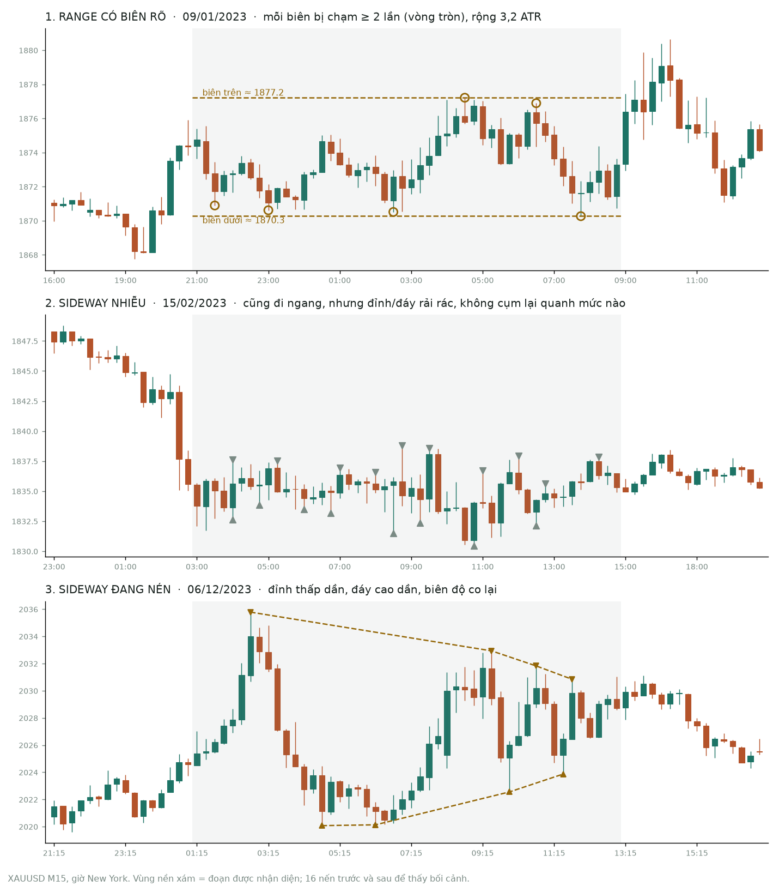

# Plan: bộ nhận diện trạng thái thị trường — trạng thái, khoảng giá, thời gian

Ngày: 21/10/2026. Trạng thái: **bản nháp chờ duyệt.** Thay cho bước 4b (`ict_regime`), đang dừng sau
[khảo sát 4a](../research/khao_sat_regime.md). Bốn câu hỏi Q-A…Q-D của 4a được trả lời ở §8.

## 1. Mục tiêu

Tại mỗi nến đã đóng, bộ nhận diện trả lời ba câu hỏi cho H giờ tới, kèm xác suất, và được chấm bằng kết cục thật:

1. **Thị trường đang ở trạng thái nào** (đọc ở H4/H1, tức bias): trend lên, trend xuống, range hay sideway.
2. **Giá có khả năng đi trong khoảng nào, tới những mức nào** (đọc ở M15, tức bias sẽ đi tới đâu).
3. **Trạng thái và khoảng đó còn giữ được bao lâu** (trong 1–4 giờ tới, cũng là thời gian giữ một lệnh vào ở M5).

## 2. Review: phần nào dự báo được

| Câu hỏi | Bằng chứng hiện có | Kỳ vọng |
|---|---|---|
| Hướng đi tiếp (lên hay xuống) | Không dự báo được: order flow ICT trong ±2 điểm % so với ngẫu nhiên; TSFM đoán hướng đúng 50–51%; hai preprint ICT 2026 đều ra null | **Thấp.** Chỉ mô tả trend hiện tại, không hứa trend đi tiếp |
| Khoảng giá (biên độ H giờ tới) | Dự báo được: biến động co cụm (RV ngày EURUSD tự tương quan 0,57), Log-HAR/GARCH là chuẩn khó thắng, mùa vụ theo giờ rất mạnh ở M15 | **Cao.** Phần mạnh nhất của bộ nhận diện |
| Mức giá sẽ chạm (pool, biên range, PDH/PDL) | Chưa đo. Giả thuyết ICT "thanh khoản hút giá" kiểm được bằng xác suất chạm so với bước ngẫu nhiên cùng biến động | **Chưa biết.** Có phép thử rõ ràng (§5) |
| Thời gian (trend/range còn bao lâu) | Yếu nếu chỉ dựa vào cấu trúc: ở 4a, trung vị tuổi thọ còn lại (M4) của baseline 0,26–0,63 ở nhịp dài, giữ đúng chiều chỉ hơn ngẫu nhiên 3–11 điểm %. Nhiều thời điểm đổi trạng thái rơi vào giờ phiên, tin, fix | **Trung bình.** Dựa vào biến động và lịch, cấu trúc chỉ bổ sung |
| Trạng thái hiện tại (mô tả) | Đã có công cụ (DC, ICT, ER/ADX), nhưng Range gần như không được nhận ra: `dc_regime` 0%, Range của bản nháp 4a chỉ 4,7% thời gian | **Cần sửa định nghĩa Range** trước |

**Kết luận review:** đặt trọng tâm vào **khoảng giá**, **mức chạm** và **thời gian theo biến động cộng lịch**. Nhãn trend/range/sideway là lớp mô tả hiện tại, đi kèm xác suất còn giữ, chứ không phải lời hứa về hướng.

## 3. Định nghĩa trạng thái (đã chốt 21/10/2026)

| Trạng thái | Định nghĩa vận hành | Nguồn có sẵn |
|---|---|---|
| Trend lên / xuống | Chuỗi đỉnh/đáy đã xác nhận cùng chiều, ER cao | `dc_atr_structure` (`DC_REGIME_UP/DOWN`), thứ tự cấp 2 của `ict_structure`, ER, ADX |
| Range | Đi ngang **có biên rõ**: trong 8–16 giờ, mỗi biên (high cao nhất / low thấp nhất) bị chạm **ít nhất 2 lần**; một lần chạm là một swing nằm trong 0,3 ATR của biên; hai lần chạm cách nhau ≥ 1,5 giờ; biên rộng 1,5–5 ATR; giá gần như không đi đâu (ER < 0,3) | Luật mới. Luật Range hiện có của `dc_atr_structure` đòi 3 đỉnh và 3 đáy cụm trong 0,5 ATR, quá chặt nên gần như không bắt được |
| Sideway nhiễu | Đi ngang (ER thấp) nhưng đỉnh/đáy rải rác, không mức nào bị chạm lặp lại, nên không có biên để dựa vào | Phần còn lại (`DC_REGIME_UNKNOWN`), ER thấp |
| Sideway nén | Đỉnh thấp dần, đáy cao dần, biên co lại (bề rộng cuối ≤ 50% lúc đầu): thường là trạng thái chờ bứt phá | Luật mới, từ swing đã xác nhận |

Đã chốt ngày 21/10/2026. Ngưỡng là bản đầu, bước 3 kiểm lại bằng nhãn tay. Ví dụ thật trên XAUUSD M15 (tái lập bằng [`research/vi_du_range_sideway.py`](../../research/vi_du_range_sideway.py)):

## 4. Đầu ra mỗi nến

**Khung (đã chốt 21/10/2026):**

| Khung | Vai trò | Thành phần |
|---|---|---|
| H4, H1 | Bias: trend hay range, giá ở vùng đắt hay rẻ | Thứ tự đỉnh/đáy, dealing range, PD array khung lớn của `ict_structure` |
| M15 | Bias sẽ đi tới đâu | Khoảng giá dự báo, pool thanh khoản, biên range, PDH/PDL, DOL kèm xác suất chạm |
| M5 | Vào lệnh (ngoài bộ nhận diện) | Dùng mức và khoảng của M15 để quyết định vào hay đứng ngoài, đặt SL/TP |

Bộ nhận diện chạy trên **M15** (đúng khung mặc định của `ict_structure`, khung lớn H1 + H4), cập nhật mỗi nến M15; biến động dựng từ M1. **H = 1 giờ và 4 giờ.** Vào lệnh M5 tốn phí khoảng 24% của 1R (SL 1,5 ATR M5, vàng), nên khoảng giá dự báo còn dùng để đứng ngoài khi biên độ dự kiến quá nhỏ so với phí.

| Trường | Ví dụ minh hoạ | Ý nghĩa |
|---|---|---|
| `trang_thai` | range | Trạng thái hiện tại (mô tả, nhân quả), kèm lý do |
| `xac_suat_giu` | 0,62 | Xác suất trạng thái còn giữ sau H giờ |
| `khoang_80` | 2.345,1 – 2.361,8 | 80% khả năng toàn bộ đường giá H giờ tới nằm trong khoảng này |
| `khoang_50` | 2.349,9 – 2.356,0 | Khoảng lõi |
| `muc_gan` | BSL 2.358,0 (62%) · biên trên range 2.360,5 (48%) | Mức cấu trúc gần nhất, kèm xác suất chạm trong H |
| `p_pha_bien` | 0,35 | Khi đang Range: xác suất phá biên trong H |
| `thoi_gian_con_lai` | trung vị 6 giờ | Thời gian còn lại của trạng thái |

## 5. Chấm đúng sai

Nhìn tương lai chỉ để chấm. Đoạn test (từ 01/09/2024) vẫn khoá.

| Đầu ra | Thước đo | Baseline phải thắng |
|---|---|---|
| Khoảng giá | Độ phủ thực tế (phải ≈ 80%, xét cả theo giờ và theo trạng thái); độ rộng trung bình tính bằng ATR; interval score (Gneiting–Raftery: phạt cả độ rộng lẫn lần trượt) | B0: ATR × √số nến · B1: B0 cộng mùa vụ theo giờ NY và ngày có tin · B2: B1 cộng Log-HAR/EWMA (bộ chuẩn biến động) |
| Xác suất chạm mức | Brier score, đường hiệu chuẩn | Xác suất chạm của bước ngẫu nhiên cùng biến động (công thức chạm biên) |
| Xác suất giữ trạng thái, phá biên | Brier, log loss | Tần suất nền theo giờ và theo tuổi trạng thái; null dịch vòng như 4a |
| Thời gian còn lại | C-index, Brier theo thời gian | Như dòng trên |

Báo cáo độ phủ theo từng giờ và từng trạng thái để thấy chỗ hỏng. Khoảng "đạt 80% trung bình" nhưng chỉ đạt 50% lúc ra tin là khoảng hỏng.

## 6. Tối ưu ICT + indicator theo mục tiêu này

Danh mục kết hợp đã thử, quyết định giữ/bỏ và lộ trình: [`plan_ket_hop_ict_indicator.md`](plan_ket_hop_ict_indicator.md).

- **Mỗi cấu hình** gồm tham số detector (`ict_structure`, `dc_atr_structure`, swing) và bộ indicator (EMA, ADX, RSI, MACD, Donchian).
- **Đặc trưng tại t:** khoảng cách tới pool hay biên tính bằng ATR; vị trí trong range hay dealing range; trạng thái và tuổi trạng thái; order flow; indicator; giờ, phiên, tin.
- **Mô hình:**
  - hồi quy phân vị (hoặc LightGBM phân vị) cho biên trên và biên dưới;
  - mô hình xác suất cho chạm mức và giữ trạng thái;
  - hiệu chỉnh độ phủ bằng conformal thích nghi.
- **Mục tiêu tối ưu:** interval score và Brier ngoài mẫu, walk-forward (train 24 tháng → kiểm 6 tháng), đúng như [protocol Copilot](../../../AI_Trading_Copilot_Protocol_v1.md) §16.5.
- **Câu hỏi quyết định:** cấu trúc ICT/DC cộng indicator có làm khoảng **hẹp hơn mà vẫn đủ độ phủ** so với B2 không?
  - Có: cấu trúc được giữ làm đầu vào dự báo.
  - Không: B2 làm lõi khoảng giá; cấu trúc chỉ dùng để mô tả và đánh dấu mức.
  - **Sơ bộ 21/10/2026: không.** So với nền (giờ + biến động gần), thêm ICT hay indicator làm dải hẹp hơn nhưng
    độ phủ tụt, điểm kém hơn ([khảo sát](../research/khao_sat_ict_indicator.md) §1.6). Chưa so với B2 thật và chưa
    thử DC / range biên rõ.
- **Kiểm soát:** sổ thử ghi mọi cấu hình (N), PBO, khoảng tin cậy bootstrap theo khối ngày cho chênh lệch interval score.

## 7. Lộ trình

| Bước | Việc | Xong khi |
|---|---|---|
| 0 | Chốt §3 (3 hay 4 trạng thái), H, mức khoảng 80% | Bạn duyệt plan |
| 1 | Bộ chuẩn khoảng giá B0–B2 và script chấm (độ phủ, interval score, theo giờ) trên dev | Có bảng điểm baseline |
| 2 | Mức chạm (M15): xác suất chạm pool, biên range, PDH/PDL trong 1 giờ và 4 giờ, so với bước ngẫu nhiên | Biết "thanh khoản hút giá" có thật hay không |
| 2b | Bias H1/H4: có đoán đúng phía nào bị chạm trước trong 1–4 giờ tới không, so với null dịch vòng | Biết bias khung lớn có thông tin về hướng hay chỉ là bối cảnh |
| 3 | Trạng thái mô tả v1: sửa Range (đang gần như không bắt được), gộp DC + ICT + ER/ADX thành 3–4 trạng thái | Tỷ lệ thời gian mỗi trạng thái hợp lý; vài trăm nhãn tay để kiểm |
| 4 | Thêm cấu trúc và indicator vào mô hình khoảng giá; tối ưu walk-forward (§6) | Biết cấu trúc có thêm thông tin so với B2 không |
| 5 | Thời gian: mô hình sống sót cho trạng thái và biên range, rủi ro đổi trạng thái theo phiên và tin | Điểm Brier/C-index so với tần suất nền |
| 6 | Đưa lên web: dải khoảng giá phía trước nến cuối, mức kèm xác suất, ô trạng thái; trang chấm dự báo có độ phủ thực tế | Xem được trên chart, kèm điểm thật |
| 7 | Copilot: router dùng trạng thái và khoảng giá (No Trade khi khoảng dự báo nhỏ hơn k × phí; SL/TP theo khoảng) | Thành ứng viên E2 trong protocol |

Bước 1–2 làm bằng script nghiên cứu trong `research/` (như `regime_survey.py`). Chỉ đưa thành thuật toán của lab khi cần chart và replay (bước 6).

**Bản đầu lên web (21/10/2026, người dùng chọn «bản đầu lên web ngay»)** — `ict_structure` 0.6.0, đặc tả
[`thuat_toan_nhan_dien.md`](../algorithms/thuat_toan_nhan_dien.md): khoảng 80% / 50% cho 1h, 4h (phân vị theo giờ NY ×
ATR, cửa sổ trượt), xác suất chạm vùng gần nhất và biên range, trạng thái 4 loại theo §3, tự chấm trong lần chạy (độ phủ,
skill so với B0, Brier, hiệu chuẩn). Giao diện làm lớp «Trạng thái» trước (người dùng chọn); khoảng giá và xác suất chạm
lên chart ở bước sau. Chưa có: conformal, nhãn tay (bước 3), `xac_suat_giu` / thời gian còn lại / `p_pha_bien` (bước 5).

**Cập nhật 21/10/2026** — [khảo sát indicator + ICT](../research/khao_sat_ict_indicator.md) (XAUUSD, EURUSD M15,
2018 – 08/2024, chỉ dev):

- **Bước 2b: xong, câu trả lời là không.** Bias H1/H4 (thứ tự ICT hay EMA50/200) đúng hướng 49,4–51,2%; muốn hoà vốn
  sau phí cần khoảng 59%. Bias khung lớn chỉ dùng làm bối cảnh.
- **Bước 2: xong phần vùng thanh khoản gần nhất.** Vùng không hút giá: xác suất chạm thấp hơn một mức bất kỳ cùng
  khoảng cách 0,2–1 điểm %. Còn lại: biên range (định nghĩa §3) và PDH/PDL đo riêng. **Xong 21/10/2026**
  ([`khao_sat_pdh_pdl.md`](../research/khao_sat_pdh_pdl.md)): PDH/PDL và biên range đúng chuẩn so với một mức bất kỳ
  cùng khoảng cách (PDH/PDL −0,3…+0,4 điểm) — không hút giá ở tổng thể; riêng ở 1–2 ATR PDH/PDL bị chạm nhiều hơn
  +0,5…+4,9 điểm (giả thuyết, chưa khai trước).
- **Bước 4: làm sơ bộ.** ICT + indicator không làm dải giá tốt hơn nền (giờ + biến động gần), còn làm kém ở 4h. Còn
  lại: B2 (Log-HAR/EWMA), conformal, đặc trưng DC, range biên rõ.

## 8. Cần chốt

| Câu hỏi | Đề xuất |
|---|---|
| Range và sideway có khác nhau không? | **Đã chốt:** khác. Range có biên rõ; sideway không có biên (nhiễu hoặc nén). Định nghĩa ở §3 |
| H | **Đã chốt:** 1 giờ và 4 giờ |
| Mức khoảng | 80%, kèm lõi 50% |
| Khung | **Đã chốt:** bias H1 + H4; đi tới đâu M15; vào lệnh M5 (ngoài bộ nhận diện) |
| Quy tắc AGENTS.md §4 (cấm gọi thuật toán là "dự báo") | **Đã sửa (21/10/2026):** chỉ được gọi là dự báo khi đầu ra có xác suất hoặc khoảng, có protocol chấm trên kết cục tương lai, có baseline, và giao diện hiện điểm thật |
| Câu hỏi 4a | Q-D: không làm `ict_regime` 4b theo bản nháp; thay bằng plan này. Q-A (nhịp): thay bằng H. Q-B (luật giữ Range): giải ở bước 3. Q-C (điều kiện K1): bỏ |
